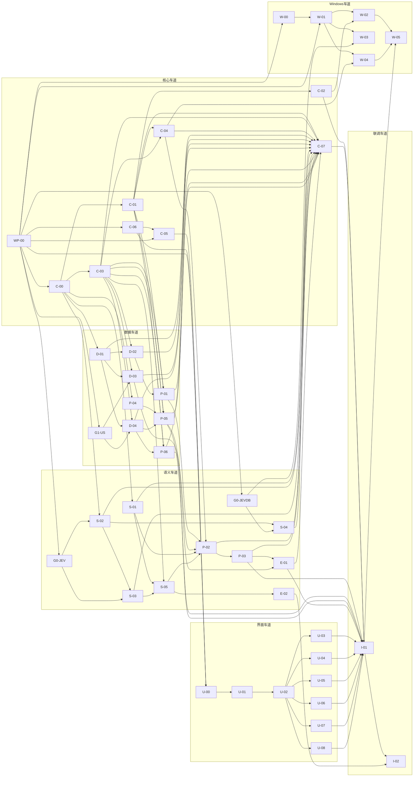

# 工作包看板

> 工作包的写法与评审门槛见 [10-协作与工作包规范.md](../10-协作与工作包规范.md)，平台分工见 [ADR-016](../decisions.md)。
> **看板部分由 `scripts/gen_wp_board.py` 生成**（数据来自各工作包文件的头部和 `backlog.json`）。新增或修改工作包后运行 `python3 scripts/gen_wp_board.py`；`--check` 检查是否过期。

## 1. 怎么用

1. 协调者先做一次**初始提交**（仓库现在还没有任何提交），才能创建分支和 worktree。
2. 找出所有依赖都已 `done` 的工作包，就是“就绪”的，可以同时派发。每条车道同时进行的建议不超过 2 个。
3. 派发时把 [10](../10-协作与工作包规范.md) 第 10 节的“实现者”提示词填好交给 agent。
4. 工作包 `done` 后更新状态列（看板生成时默认写“待派发”，请在派发后手工维护一份副本或使用你们的任务系统；本表只负责依赖与波次）。`platform: shared` 的工作包合并后，通知 Windows 的人更新对等矩阵。
5. **`backlog.json` 里有、但还没有对应 `.md` 文件的工作包**，必须先按 [10](../10-协作与工作包规范.md) 第 5 节的模板写成完整文档（满足 D1–D10），才能派发。
6. **Windows 分阶段恢复（ADR-021）**：当前只派发 `W-00` 环境摸底；`W-01`～`W-05` 在 W-00 结论被协调者审阅前继续暂缓。macOS MVP-0 与 M-8 口径不变。

## 2. 车道与分工

| 车道 | 谁做 | 工作包前缀 | 主要内容 |
|---|---|---|---|
| 核心 `core` | Mac 主线 | `WP-00` `C-` | 骨架、RPC、存储、设置与密钥、前端 RPC 客户端、契约文件 |
| 数据 `data` | Mac 主线 | `G1-` `D-` `P-01` `P-04`～`P-06` | SEC 抓取、行情、持仓与逻辑、模拟交易、风险 |
| 语义 `semantic` | Mac 主线 | `G0-` `S-` `P-02` `P-03` `E-` | 引擎、判定流水线、扫描、清单、演示数据与评测 |
| 界面 `ui` | Mac 主线 | `U-` | 外壳、组件、六个页面 |
| 联调 `integration` | Mac 主线 | `I-` | 真实联调与验收 |
| **Windows** | **一个人** | `W-` | 平台层、桥接对等、JEVDB 的 MSVC 构建、凭据管理器、Windows 联调 |

三条规则让两条线互不拖累（[ADR-016](../decisions.md)）：

- Mac 与共享工作包**不得依赖** Windows 工作包（检查脚本强制）。Mac 工作包的 `done` 不等 Windows。
- 平台差异只放平台层目录；Windows 发现共享代码的问题，只提交“最小修复 + 复现测试”，不改共享接口。
- Windows 的验收单独记录（[01](../01-产品需求.md) 第 8 节）。

## 3. 看板

**关键路径（Mac）**：WP-00 → C-00 → C-03 → D-02 → P-01 → P-02 → P-03 → E-01 → I-01 → I-02。想缩短总工期，就保证这条链上的工作包不被阻塞，并尽早启动 G0-JEV、G0-JEVDB、G1-US 三个探针和 C-06（契约文件）——它们决定后面很多工作包的假设与输入。

**界面车道的并行性**：U-00 起对着 mock 数据开发（C-06 提供契约示例、C-05 提供类型与 mock 层），不等后端；到 I-01 才接真实核心进程。

<!-- BOARD:BEGIN（由 scripts/gen_wp_board.py 生成，请勿手改）-->

MVP-0 共 46 个工作包：Mac 与共享 40 个，Windows 6 个。全部 46 个均已写完整文档，可派发。

### 波次

同一波次内的工作包彼此没有依赖，可以同时做。波次编号 = 依赖链的最长层数。

| 波次 | Mac 与共享 | Windows |
|---|---|---|
| 0 | WP-00 | — |
| 1 | C-00、C-06、G0-JEV、G0-JEVDB、G1-US | W-00 |
| 2 | C-01、C-03、C-05、D-01、P-04、S-01、S-02 | W-01 |
| 3 | C-02、C-04、D-02、D-03、D-04、S-03、S-04、U-00 | W-03 |
| 4 | P-01、P-05、P-06、S-05、U-01 | W-02、W-04 |
| 5 | E-02、P-02、U-02 | — |
| 6 | P-03、U-03、U-04、U-05、U-06、U-07、U-08 | — |
| 7 | E-01 | — |
| 8 | C-07 | — |
| 9 | I-01 | — |
| 10 | I-02 | W-05 |

### 依赖图

### 完整看板

规模：S < 300 行，M 300–800 行（代码加测试）。“状态”取值：待派发 / doing / review / done。

| ID | 标题 | 车道 | 平台 | 规模 | 波次 | 依赖 | 文档 | 状态 |
|---|---|---|---|---|---|---|---|---|
| [WP-00](mvp0/WP-00-skeleton.md) | 仓库骨架与工具链 | 核心 | 共享 | M | 0 | — | 已写 | done |
| [C-00](mvp0/C-00-core-utils.md) | 基础模块：ID、时钟、错误、日志、脱敏、文案 | 核心 | 共享 | S | 1 | WP-00 | 已写 | 待派发 |
| [C-06](mvp0/C-06-contracts.md) | 契约文件与原型数据生成 | 核心 | 共享 | M | 1 | WP-00 | 已写 | 待派发 |
| [G0-JEV](mvp0/G0-JEV-probe.md) | 闸门探针：Jev 直连实测 | 语义 | 共享 | S | 1 | WP-00 | 已写 | 待派发 |
| [G0-JEVDB](mvp0/G0-JEVDB-build.md) | 闸门探针：macOS 构建并加载 JEVDB | 语义 | macOS | M | 1 | WP-00 | 已写 | 待派发 |
| [G1-US](mvp0/G1-US-market-probe.md) | 闸门探针：SEC、行情源实测与录制 | 数据 | 共享 | S | 1 | WP-00 | 已写 | 待派发 |
| [W-00](mvp0/W-00-windows-survey.md) | Windows 环境摸底与对等矩阵 | Windows | Windows | S | 1 | WP-00 | 已写 | doing |
| [C-01](mvp0/C-01-rpc-server.md) | RPC 服务端：线程模型、分发、取消 | 核心 | 共享 | M | 2 | C-00 | 已写 | 待派发 |
| [C-03](mvp0/C-03-storage.md) | 存储：DuckDB 封装、迁移、备份 | 核心 | 共享 | M | 2 | C-00 | 已写 | 待派发 |
| [C-05](mvp0/C-05-frontend-rpc.md) | 前端 RpcClient、mock 与契约类型生成 | 核心 | 共享 | M | 2 | C-06, WP-00 | 已写 | 待派发 |
| [D-01](mvp0/D-01-http.md) | HTTP 基础设施：重试、熔断、限速、缓存 | 数据 | 共享 | M | 2 | C-00 | 已写 | 待派发 |
| [P-04](mvp0/P-04-trading-rules.md) | 模拟交易规则：校验、费用、撮合 | 数据 | 共享 | S | 2 | C-00 | 已写 | 待派发 |
| [S-01](mvp0/S-01-segment.md) | 分句与分段 | 语义 | 共享 | S | 2 | C-00 | 已写 | 待派发 |
| [S-02](mvp0/S-02-engine-interface.md) | 引擎接口、问题集、classify、定价与预算 | 语义 | 共享 | M | 2 | C-00, G0-JEV | 已写 | 待派发 |
| [W-01](mvp0/W-01-windows-platform-layer.md) | Windows 平台层实现 | Windows | Windows | M | 2 | WP-00, W-00 | 已写 | 待派发 |
| [C-02](mvp0/C-02-tauri-bridge.md) | Rust 桥接：核心进程监督与消息转发 | 核心 | 共享 | M | 3 | C-01 | 已写 | 待派发 |
| [C-04](mvp0/C-04-settings-secrets.md) | 设置与密钥：settings.*、secrets.*、app.bootstrap | 核心 | 共享 | M | 3 | C-01, C-03 | 已写 | 待派发 |
| [D-02](mvp0/D-02-instruments.md) | 美股标的表与搜索 | 数据 | 共享 | M | 3 | C-03, D-01 | 已写 | 待派发 |
| [D-03](mvp0/D-03-sec-filings.md) | SEC 披露抓取与正文提取 | 数据 | 共享 | M | 3 | C-03, D-01, G1-US | 已写 | 待派发 |
| [D-04](mvp0/D-04-prices-calendar.md) | 日线行情与交易日历 | 数据 | 共享 | M | 3 | C-03, D-01, G1-US | 已写 | 待派发 |
| [S-03](mvp0/S-03-jev-direct.md) | Jev 直连引擎 | 语义 | 共享 | M | 3 | S-02, G0-JEV | 已写 | 待派发 |
| [S-04](mvp0/S-04-jevdb-engine.md) | JEVDB 引擎 | 语义 | 共享 | M | 3 | S-02, G0-JEVDB | 已写 | 待派发 |
| [U-00](mvp0/U-00-shell.md) | 前端应用外壳、令牌、路由、状态骨架 | 界面 | 共享 | M | 3 | C-05, C-06, WP-00 | 已写 | 待派发 |
| [W-03](mvp0/W-03-windows-jevdb.md) | Windows 上尝试构建 JEVDB（MSVC） | Windows | Windows | M | 3 | W-01, G0-JEVDB | 已写 | 待派发 |
| [P-01](mvp0/P-01-holdings-thesis.md) | 持仓与投资逻辑 | 数据 | 共享 | M | 4 | C-01, C-03, D-02 | 已写 | 待派发 |
| [P-05](mvp0/P-05-paper-account.md) | 模拟账户与订单：账本、回放时钟 | 数据 | 共享 | M | 4 | P-04, C-03, D-04, C-01 | 已写 | 待派发 |
| [P-06](mvp0/P-06-risk.md) | 风险计算 | 数据 | 共享 | M | 4 | C-03, D-04, C-01 | 已写 | 待派发 |
| [S-05](mvp0/S-05-decision-pipeline.md) | 判定流水线：证据、缓存、落库 | 语义 | 共享 | M | 4 | S-01, S-03, C-03 | 已写 | 待派发 |
| [U-01](mvp0/U-01-components.md) | 组件库 | 界面 | 共享 | M | 4 | U-00 | 已写 | 待派发 |
| [W-02](mvp0/W-02-windows-bridge.md) | Windows 核心进程桥接对等 | Windows | Windows | M | 4 | W-01, C-02 | 已写 | 待派发 |
| [W-04](mvp0/W-04-windows-credentials.md) | Windows 凭据管理器验证 | Windows | Windows | S | 4 | W-01, C-04 | 已写 | 待派发 |
| [E-02](mvp0/E-02-eval.md) | 标注集与评测脚本 | 语义 | 共享 | M | 5 | S-05 | 已写 | 待派发 |
| [P-02](mvp0/P-02-scan-orchestration.md) | 扫描编排：水位线、批次、进度、取消 | 语义 | 共享 | M | 5 | P-01, D-03, S-01, S-05, C-04 | 已写 | 待派发 |
| [U-02](mvp0/U-02-today.md) | 今日页与证据抽屉 | 界面 | 共享 | M | 5 | U-01 | 已写 | 待派发 |
| [P-03](mvp0/P-03-pending-list.md) | 待处理清单与处理动作 | 语义 | 共享 | M | 6 | P-02 | 已写 | 待派发 |
| [U-03](mvp0/U-03-holdings.md) | 持仓页与逻辑编辑器 | 界面 | 共享 | M | 6 | U-02 | 已写 | 待派发 |
| [U-04](mvp0/U-04-scan.md) | 扫描页 | 界面 | 共享 | M | 6 | U-02 | 已写 | 待派发 |
| [U-05](mvp0/U-05-trading.md) | 交易页 | 界面 | 共享 | S | 6 | U-02 | 已写 | 待派发 |
| [U-06](mvp0/U-06-risk.md) | 风险页 | 界面 | 共享 | M | 6 | U-02 | 已写 | 待派发 |
| [U-07](mvp0/U-07-settings.md) | 设置页 | 界面 | 共享 | M | 6 | U-02 | 已写 | 待派发 |
| [U-08](mvp0/U-08-feedback.md) | 全局反馈：Toast、错误边界、核心状态与离线横幅 | 界面 | 共享 | S | 6 | U-02 | 已写 | 待派发 |
| [E-01](mvp0/E-01-demo-data.md) | 演示数据与载入脚本 | 语义 | 共享 | M | 7 | P-03, P-05 | 已写 | 待派发 |
| [C-07](mvp0/C-07-composition-root.md) | 组合根与进程入口：装配服务、注册处理器、启动恢复 | 核心 | 共享 | M | 8 | C-01, C-03, C-04, D-01, D-02, D-03, D-04, S-01, S-02, S-03, S-04, P-01, P-02, P-03, P-05, P-06, E-01 | 已写 | 待派发 |
| [I-01](mvp0/I-01-integration.md) | 联调：真实核心进程 + 真实前端 | 联调 | 共享 | M | 9 | C-02, C-07, P-03, P-05, P-06, E-01, U-03, U-04, U-05, U-06, U-07, U-08 | 已写 | 待派发 |
| [I-02](mvp0/I-02-acceptance.md) | MVP-0 验收与 5 分钟演示 | 联调 | 共享 | M | 10 | I-01, E-02 | 已写 | 待派发 |
| [W-05](mvp0/W-05-windows-acceptance.md) | Windows MVP-0 联调与验收 | Windows | Windows | M | 10 | W-02, W-04, I-01 | 已写 | 待派发 |

<!-- BOARD:END -->

## 4. 三个探针的作用

探针工作包只做实测、录制、写结论，**不写产品代码**，但它们的结论会改变后面工作包的行为，所以要最先做。

| 探针 | 回答的问题 | 结论写到哪里 | 影响 |
|---|---|---|---|
| G0-JEV | `jev-1.14.0` 可用吗？延迟、token 计量、限流行为？打包多条逻辑是否可靠？证据句定位准不准？中文逻辑 × 英文段落的表现？ | [decisions.md](../decisions.md) 附录 | S-02 的问题集阈值与定价、S-03 |
| G0-JEVDB | JEVDB 能在 macOS arm64 上构建并加载吗？ | 同上 | 能：S-04 实现 JEVDB 引擎并服务 M-8；不能：S-04 只留接口与降级测试，最终验收 BLOCKED |
| G1-US | SEC 接口字段与 User-Agent 要求？哪个行情源在你们的网络下可用？ | 同上，并录制测试数据 | D-02、D-03、D-04 |

## 5. 对等矩阵

Windows 车道维护 `docs/wp/windows-matrix.md`（由 W-00 创建）：每个共享工作包在 Windows 上的验证结果。

## 6. v1 及以后

v1 的工作包（macOS 托盘与安装包 `M-`、Windows 托盘与安装包 `W-1x`、定时调度、通知、复盘页、CSV 导入等）在 MVP-0 验收后再写，放在 `docs/wp/v1/`。
